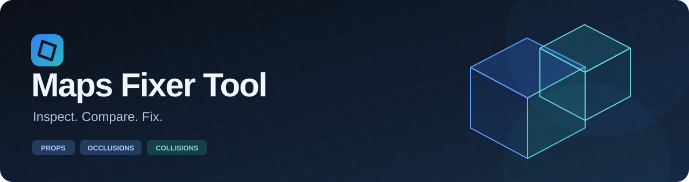

  

  <strong>Find mapping conflicts. See what is affected. Choose what to fix.</strong> 
  A Windows desktop tool for FiveM server owners and mapping creators.

  
  
  

  <a href="https://github.com/Mylaano/maps-fixer-tool-releases/releases/latest"><strong>↓ Download for Windows</strong></a>
  &nbsp; · &nbsp;
  <a href="#getting-started">Getting started</a>
  &nbsp; · &nbsp;
  <a href="#free--pro">Free & Pro</a>
  &nbsp; · &nbsp;
  <a href="https://github.com/Mylaano/maps-fixer-tool-releases/issues">Support</a>

---

## Your mappings, easier to understand

Overlapping resources can cause disappearing objects, unwanted occlusion and conflicting collisions. Maps Fixer Tool helps you inspect these conflicts, identify the resources involved and review a targeted correction before changing your files.

| Area | What you can do |
| :--- | :--- |
| **Occlusions · YMAP** | Compare occlusion volumes between versions of a mapping and select individual boxes or conflicting triangles. |
| **Collisions · YBN** | Inspect collision conflicts and select the supported geometry to correct. |
| **Props** | Find conflicting prop placements across resources and select the props to disable. |
| **Interactive previews** | Inspect supported conflicts in 2D or in the integrated GTA V 3D view, with resource colors and clickable elements. |
| **Backups & restoration** | Keep automatic backups before corrections and restore files from the application. |

### Built for a clearer workflow

- **Know what you are selecting.** Identify the resource associated with a selected element.
- **Stay focused.** Filter by props, occlusions or collisions, search resources and sort the conflict list.
- **Inspect the area around you.** Refresh nearby conflicts from the 3D camera position.
- **Review before applying.** Check the selected changes in the confirmation dialog.
- **Make it yours.** Use the light or dark theme, optional animations and your preferred interface language.

**Available languages:** English · Français · Español · Português (Brasil) · Italiano.

## Getting started

### 1. Download the application

Open the **[latest release](https://github.com/Mylaano/maps-fixer-tool-releases/releases/latest)** and expand **Assets** if needed.

Download the file named **`MapsFixerTool-<version>-portable.exe`**.

> Choose the **portable .exe**, rather than the “Source code” archives or `update.json`. No Node.js installation or development setup is needed.

### 2. Open your resources folder

Launch the executable, select your server’s **resources** folder and run the analysis. Use the filters to explore the conflicts found in your mappings.

### 3. Inspect and select

Select a conflict to inspect the affected resources. Use the 2D view or enable the integrated 3D view, then select the supported elements you want to correct.

### 4. Review and apply

With Pro access or an active Pro trial, add elements to the correction selection and review the summary before confirming. Original files are backed up before modification.

Restart the affected resource or your server, then verify the result in game. You can restore a backup from the **Backups** section.

## Requirements

| Requirement | Details |
| :--- | :--- |
| **Operating system** | Windows 10 or Windows 11, 64-bit. |
| **Mapping files** | Access to the FiveM resources you want to analyse and permission to modify them when applying corrections. |
| **Internet connection** | Required for account sign-in, subscription validation and downloading updates. |
| **CodeWalker** | A separate compatible installation is required for the integrated 3D view and YBN support. The current integration targets **CodeWalker 30 dev46**. |
| **GTA V 3D map** | A local **GTA V Legacy** installation and a graphics device compatible with DirectX 11. |

GTA V and CodeWalker are **not included** in this download. Follow the application’s folder selection prompts when enabling the 3D view.

## Free & Pro

**Start with the free plan to analyse your resources and inspect the results.**

| Feature | Free | Pro / active Pro trial |
| :--- | :---: | :---: |
| Analyse supported mappings and inspect conflicts | ✓ | ✓ |
| Use the available previews and filters | ✓ | ✓ |
| Apply supported corrections | — | ✓ |
| Restore existing application backups | ✓ | ✓ |

### Pro — €9.90 / month

A **7-day Pro trial** is available to eligible accounts during subscription checkout. Stripe displays the trial end date, subscription price and first payment date before you confirm.

After the trial, the subscription renews monthly at **€9.90** unless cancelled. You can manage or cancel it through **My account → Manage subscription**.

Manage your account, trial time remaining, subscription and authorised devices from **My account**. Up to **two devices** can be authorised on an account.

The basic free plan has no expiry date; the **Pro trial** is limited to seven days. An internet connection is required to validate Pro access before corrections.

## Updates

When a newer version is available, the application shows an **update button next to Settings**.

Open it to read the changes in your interface language, check the version and download the update with progress and download speed displayed. You can also download the latest executable directly from this repository.

## Need a hand?

**[Report a bug or ask a question →](https://github.com/Mylaano/maps-fixer-tool-releases/issues)**

Include your application version, Windows version, the steps to reproduce the issue and any relevant error message. A screenshot can help.

Please remove personal information from screenshots and **do not post passwords, login codes, API keys or paid mapping files** in public issues.

## Credits & acknowledgements

Maps Fixer Tool builds on the work of these projects and their contributors:

- **[CodeWalker](https://github.com/dexyfex/CodeWalker)** — Created by **dexyfex**. Powers the integrated GTA V 3D preview and collision-file support through a separate local installation.
- **[HeroUI](https://www.heroui.com/)** — Provides the UI styling and design system, customised for Maps Fixer Tool’s light and dark themes.
- **[Electron](https://www.electronjs.org/)** — Provides the desktop application framework.
- **[Tailwind CSS](https://tailwindcss.com/)** — Used to build the interface styles.
- **[SharpDX](https://github.com/sharpdx/SharpDX)** — Provides the DirectX bindings used by the CodeWalker integration.

Thank you to the authors, maintainers and contributors behind these projects.

Third-party projects retain their respective copyrights and licensing terms. Their inclusion in these credits does not imply endorsement of Maps Fixer Tool.

---

  <strong>Maps Fixer Tool</strong> 
  Public downloads, release notes and support. 
  Independent project. Not affiliated with Rockstar Games, Cfx.re or the CodeWalker project.

